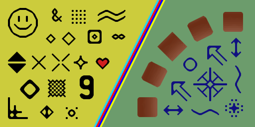

# xBRgo

**xBRgo** is a Go implementation of the xBR pixel-art scaling algorithm. It
can be used either as a Go package or as a command-line tool for processing a
directory of images.




## Requirements

- Go 1.21 or newer

## Use xBRgo as a Go package

### 1. Install the package

From your Go project, run:

```bash
go get github.com/maicudev/xBRgo
```

### 2. Scale an image

The package accepts any `image.Image` and returns a scaled `image.Image`:

```go
package main

import (
	"image"
	"image/png"
	"os"

	xbr "github.com/maicudev/xBRgo"
)

func main() {
	input, err := os.Open("input.png")
	if err != nil {
		panic(err)
	}
	defer input.Close()

	src, _, err := image.Decode(input)
	if err != nil {
		panic(err)
	}

	scaled, err := xbr.Scale(src, 4, xbr.DefaultOptions())
	if err != nil {
		panic(err)
	}

	output, err := os.Create("output.png")
	if err != nil {
		panic(err)
	}
	defer output.Close()

	if err := png.Encode(output, scaled); err != nil {
		panic(err)
	}
}
```

Supported package scale factors are `1`, `2`, `3`, `4`, `6`, and `8`.
Factors `6` and `8` use multiple xBR passes:

- `6x`: `3x` followed by `2x`
- `8x`: `4x` followed by `2x`

### Configure the scaling options

`xbr.DefaultOptions()` enables xBR color blending. To use exact
nearest-neighbor pixel blocks instead, set `BlendColors` to `false`:

```go
options := xbr.Options{
	BlendColors: false,
	ScaleAlpha:  false,
}

scaled, err := xbr.Scale(src, 4, options)
```

When blending is disabled, `Scale` preserves each source pixel as an exact
block. `ScaleAlpha` controls whether alpha participates in xBR edge detection
and scaling; it has no effect in nearest-neighbor mode.

## Build the command-line tool

From the repository root, build the executable with:

```bash
go build -C cli -o ./xbr
```

## Use the command-line tool

The CLI processes image files directly inside an input directory. It supports
PNG, JPG, JPEG, and GIF input files and writes PNG files to the output
directory. Subdirectories are not scanned, and the output directory is
created automatically.

### Basic usage

```bash
./xbr -factor 4 ./input ./output
```

The `-factor` option supports `2`, `3`, `4`, `6`, and `8`, and defaults to `2`.

### CLI options

| Option | Default | Description |
| --- | ---: | --- |
| `-factor` | `2` | Scale factor: `2`, `3`, `4`, `6`, or `8`. |
| `-blend` | `true` | Blend colors on xBR-generated edges. Set to `false` for exact pixel blocks. |
| `-scale-alpha` | `false` | Include alpha when detecting and scaling xBR edges. |

For example, to create a pixel-perfect 4x result:

```bash
./xbr -factor 4 -blend=false ./input ./output
```

To use xBR with alpha-aware edge detection:

```bash
./xbr -factor 4 -blend=true -scale-alpha=true ./input ./output
```

Show all command-line options with:

```bash
./xbr -h
```

## Credits

This implementation is based on the
[xBRjs](https://github.com/joseprio/xBRjs) implementation and the xBR pixel-art
scaling algorithm. The 2x, 3x, and 4x kernels, as well as the multi-pass
behavior for 6x and 8x scaling, were ported to Go.
